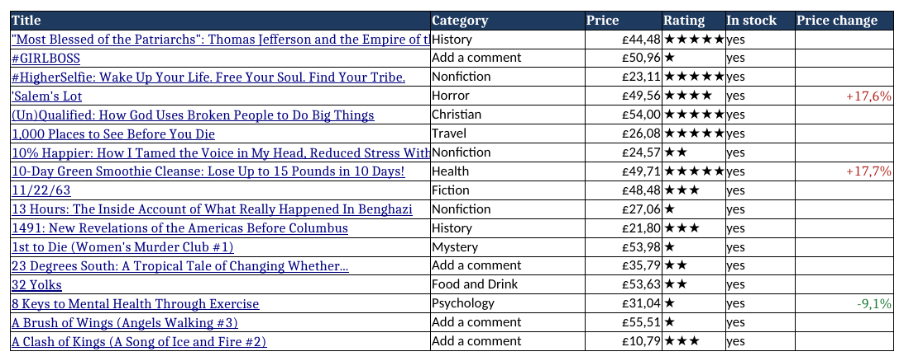
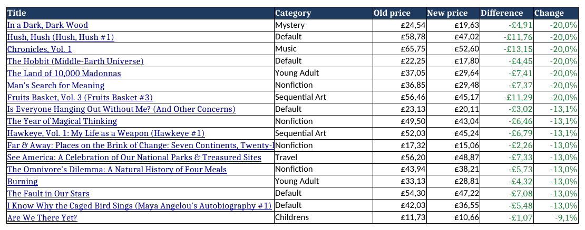
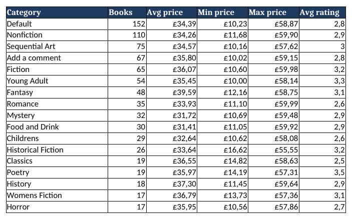

# Book Price Tracker

Scrapes an online shop, keeps a price history and builds a formatted Excel report:
full catalog, price changes since the last run, new / removed products and a summary by category.

Demo target: [books.toscrape.com](https://books.toscrape.com/) — a sandbox shop made for scraping practice
(1000 products, 50 categories, pagination).



## What it does

- Walks through **all categories and all pages** of the shop (~1000 products in about a minute).
- Collects title, category, price, rating, availability and product link.
- Saves every run into a local **SQLite** history (`prices.db`).
- Compares the run with the previous one: **price drops / rises, new and removed products**.
- Exports a ready-to-use **Excel report** — colored headers, filters, frozen header row,
  clickable links, price/percent formats, green = cheaper, red = more expensive.
- Polite scraping: delay between requests, retries on network errors, timeouts.

| Price changes | Summary by category |
|---|---|
|  |  |

A full example report: [`examples/sample_report.xlsx`](examples/sample_report.xlsx).

## Quick start

```bash
python -m venv .venv
source .venv/bin/activate          # Windows: .venv\Scripts\activate
pip install -r requirements.txt

python main.py                     # whole shop -> report.xlsx
python main.py --categories 3      # quick test on 3 categories
python main.py --out prices.xlsx   # custom report name
```

Run it again later (manually, or daily via cron / Task Scheduler) and the
**Price changes** sheet will show what changed since the previous run.

### How runs are compared

Each run remembers what it covered: the whole shop, or only some categories (`--categories N`).

- **New products** — books that weren't there before, including books from a brand-new category.
- **Removed products** — reported only for categories the new run actually checked, so a quick
  partial run never claims that the rest of the shop disappeared.
- A full run is always compared with the **previous full run**, so quick test runs in between
  don't break daily tracking.

> **Note on `--demo`.** The sandbox shop never changes its prices, so the
> "Price changes" sheet would always be empty. `python main.py --demo` randomly shifts ~5%
> of prices in the *previous* saved run before comparing, just to show how the report looks.
> The screenshots above were made this way. Don't use it on real data.

## Project structure

```
scraper.py   downloading + parsing HTML (the only site-specific part)
storage.py   SQLite price history and run comparison
report.py    Excel report (openpyxl)
main.py      command-line entry point
tests/       offline tests for parsing and comparison (pytest)
```

To adapt it to another shop, rewrite the `parse_*` functions in `scraper.py` —
storage, comparison and the report stay the same. For sites that render content with
JavaScript, the download step can be switched to Playwright.

## Tech

Python 3.10+, requests, BeautifulSoup, openpyxl, SQLite, pytest.

```bash
pip install pytest && pytest -q
```

---

## Кратко по-русски

Парсер интернет-магазина с историей цен и выгрузкой в Excel. Обходит все категории и страницы,
собирает название, категорию, цену, рейтинг, наличие и ссылку. Каждый запуск сохраняет в SQLite
и сравнивает с предыдущим: что подешевело, подорожало, появилось или пропало. Результат — оформленный
Excel-отчёт с фильтрами, ссылками и цветовой подсветкой изменений. Под другой магазин адаптируется
заменой функций разбора в `scraper.py`.
